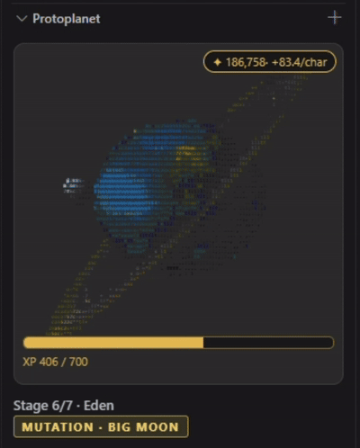
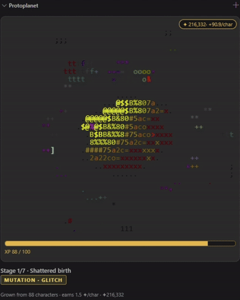
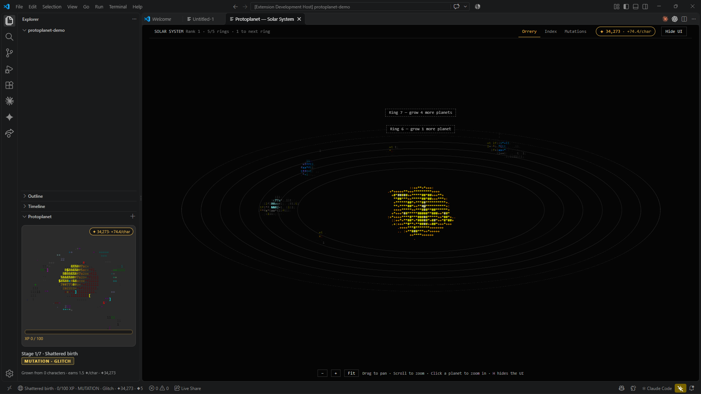

# Protoplanet

Type, and a little ASCII planet grows in your editor.

## Install

**From the Marketplace:** open the Extensions view in VS Code, search for
**Protoplanet**, and click Install.

**From Quick Open:** press Ctrl+P (or Cmd+P on Mac), paste
`ext install devoncline.protoplanet`, and press Enter.

**From a `.vsix` file:** Extensions view → **…** → **Install from VSIX…**,
then pick the file.

Requires VS Code 1.85 or later.

## How it works

Every character you type is 1 XP for your planet. Deletions don't count.
Your planet grows through seven stages:

| Stage | XP to reach it |
| --- | --- |
| Shattered birth | 0 |
| Accretion | 100 |
| Molten | 300 |
| Crust | 600 |
| Tides | 1,000 |
| Eden | 1,500 |
| Civilization | 2,200 |

At Civilization the XP bar turns orange and the planet just keeps growing —
there's no forced rebirth. When you want a new planet, you start one.

Your first planet is free. After that, a new planet costs one Birth Mineral.

The planet lives in the Explorer sidebar, with your stage and XP in the
status bar. Pick a starter terrain on your first run — icy, lava, jungle,
rocky, or ocean — and every planet gets a catalog-style name tied to its
seed. Same seed, same planet.

I built this for myself first — a planet that grows while I code.

## Mutations

About 1 in 10 planets is born with a rare mutation — a blood moon, glowing
oceans, double rings, a comet, and nine more. A planet can carry more than
one. Mutations boost how much Stardust the planet earns, and matching sets
(like Moon Lord or Ring King) are worth collecting.

## Minerals and the shop

Minerals are what you spend. There are two kinds:

- **Birth Mineral** — pays for one new planet. 2,500 ✦ in the shop.
- **Mutation Mineral** — one exact mutation, applied to your growing planet
  on a 50/50 flip. It works or it's gone either way. Random ones cost
  250,000 ✦, family picks (Moon, Rings, Glow, or Sky) cost 400,000 ✦.

You earn Stardust for every character you type — never passively, never
while you're away. A Civilization planet with mutations earns far more per
character than a newborn, so growing planets pays for the next ones.

Every price and every odd is shown before you commit to anything.

## Salvage and prestige

**Salvage** a planet to get minerals back. A planet salvaged at Crust
(600 XP) or later returns its mutation minerals plus a Birth Mineral; a
Civilization planet returns two Birth Minerals. Salvage below Crust and
the mutations are lost — grow it first if you want them back.

**Prestige** two Civilization planets into a child. The child inherits
each parent's mutations — 50% from one parent, 75% if both carry it.
Parents stay in your collection, and each planet can only be a parent
once.

## Solar system

Finished planets go into your solar system — a tilted orrery around a
star, plus an Index of your whole collection. Finishing more planets
unlocks more rings. Click a planet to zoom in and
see its details.

## Share a planet

Every planet has a seed. Share it and a friend can hatch the same base
planet on their machine — same terrain, rings, moons, and name, but
without your mutations. Those stay yours.

## Commands

| Command | What it does |
| --- | --- |
| Protoplanet: Show pet | Open the sidebar pet view |
| Protoplanet: New planet | Start a new planet (costs 1 Birth Mineral after the first) |
| Protoplanet: Apply a mineral to your planet | Apply a Mutation Mineral to the growing planet (50/50) |
| Protoplanet: Salvage / recycle a planet | Destroy or recycle a planet for minerals |
| Protoplanet: Prestige two planets | Combine two Civilization planets into a child |
| Protoplanet: Open prestige | Open the prestige picker |
| Protoplanet: Open solar system | Open the orrery and Index |
| Protoplanet: Share planet | Share the current planet (PNG, seed, or Markdown) |
| Protoplanet: Hatch from seed | Hatch a planet from a shared seed |
| Protoplanet: View mineral inventory | See your minerals |
| Protoplanet: Open shop | Buy minerals with Stardust |

## Known limitations

- **Saves are local to one machine.** Everything is stored in VS Code on
  the computer where you play — no account, no server, nothing leaves your
  computer. There is no sync between machines and no export yet, so a
  planet can't move to another computer for now. Export is planned.
- **Early release.** This is 0.1.0. Things will change, and there will be
  rough edges. Bugs and ideas are welcome on the
  [GitHub repo](https://github.com/devoncline/protoplanet).

## Changelog and license

See [CHANGELOG.md](CHANGELOG.md) for what's in each release. Protoplanet
is [MIT licensed](LICENSE).
